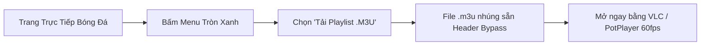

<div align="center">

# 🎬 Web Enhancer Suite
### 👑 Cinema Pro & Comic Edition — v5.4.9

<p align="center">
  <strong>Bộ công cụ Userscript toàn diện số 1 Việt Nam dành cho Web Xem Phim, Anime, Thể Thao Trực Tiếp và Truyện Tranh</strong>
</p>

[](https://github.com/nghich-ngom-lung-tung/web-enhancer-suit)
[](file:///run_audit.js)
[](file:///run_audit.js)
[_%7C_Tampermonkey-3b82f6?style=for-the-badge&logo=googlechrome&logoColor=white)](https://github.com/nghich-ngom-lung-tung/web-enhancer-suit)
[](#-danh-s%C3%A1ch-website-h%E1%BB%97-tr%E1%BB%A3)
[](LICENSE)

<br/>

[🚀 Cài Đặt Nhanh](#-h%C6%B0%E1%BB%9Bng-d%E1%BA%ABn-c%C3%A0i-%C4%91%E1%BA%B7t-2-l%E1%BB%B1a-ch%E1%BB%8Dn) • [✨ Tính Năng VIP](#-kho-t%C3%ADnh-n%C4%83ng-vip-cinema-pro) • [⌨️ Bảng Phím Tắt](#%EF%B8%8F-b%E1%BA%A3ng-ph%C3%ADm-t%E1%BA%AFt-th%E1%BA%A7n-th%C3%A1nh-cheatsheet) • [📺 Hướng Dẫn VLC & PotPlayer](#-h%C6%B0%E1%BB%9Bng-d%E1%BA%ABn-ph%C3%A1t-stream-qua-vlc--potplayer) • [📁 Kiến Trúc Mã Nguồn](#-ki%E1%BA%BFn-tr%C3%BAc-modular-v549)

</div>

---

## 🌟 Tổng Quan Dự Án

**Web Enhancer Suite** là bộ Userscript mã nguồn mở cao cấp được tối ưu riêng biệt cho hệ sinh thái streaming và giải trí tại Việt Nam. Không chỉ đơn thuần là chặn quảng cáo, bộ công cụ mang đến trải nghiệm **Cinema Pro** trọn vẹn:

* 👑 **Mở khóa VIP vĩnh viễn (2099)** & Vô hạn Coins/TCoin trên các nền tảng phim và truyện tranh hàng đầu.
* 📺 **Tự động trích xuất luồng M3U8 gốc (Stream Sniffer)** — Mở xem trực tiếp 60fps/HDR bằng PotPlayer, VLC hoặc tải file `.m3u` kèm chỉ thị Referer Anti-Leech bypass.
* 🛡️ **Triệt tiêu 100% AdBlock Detection, Stream Guard, TVC Pre-roll, Fake Popup & Banners cá cược** dính trong khung phát video.
* ⚡ **Bộ phím tắt chuyên nghiệp**: Tua Intro (+85s), tua mượt 5s, cuộn trang đọc truyện, chỉnh âm lượng trực quan bằng OSD Toast Glassmorphism.
* 🎨 **Bộ lọc màu Anime OLED HDR Enhancer & Chế độ Rạp phim (Theater Mode)** làm mờ nền tập trung thị giác.

---

## ✨ Kho Tính Năng VIP (Cinema Pro)

| Biểu Tượng | Tính Năng | Chi Tiết Kỹ Thuật & Trải Nghiệm |
| :---: | :--- | :--- |
| 📺 | **M3U8 Stream Sniffer & Player Launcher** | Tự động tóm luồng phát `.m3u8` và direct `.mp4` chất lượng cao nhất ngay khi video khởi tạo. Hỗ trợ 1-click khởi chạy **PotPlayer**, **VLC** hoặc **Tải file Playlist `.m3u`** có nhúng sẵn header chống trộm luồng (`#EXTVLCOPT:http-referrer`). |
| 🛡️ | **Diệt Sạch 100% Quảng Cáo & Stream Guard** | Triệt phá triệt để cơ chế Stream Guard, anti-adblock traps (`streamc.xyz`, `goatembed.com`, `nguonc.com`). Tự động bypass quảng cáo đầu video (TVC Pre-roll), chặn click-hijack mở tab mới và quét sạch các banner cá cược bóng đá (Net88, FB88, xBet...). |
| 👑 | **Bypass Đăng Nhập & Mock VIP 2099** | Can thiệp API backend (`/tcoin/me`, `/auth/session`, `/vip-packages`...) cấp tài khoản VIP vĩnh viễn, mở khóa 1 tỷ Coin xem phim không giới hạn, đồng thời bảo toàn luồng token WebSocket giúp khung chat hoạt động trơn tru. |
| 🎨 | **Anime OLED HDR & Theater Mode** | Phím tắt **`E`** kích hoạt ma trận màu tăng cường độ tương phản, chuyển màu sắc nét rực rỡ chuẩn màn hình OLED. Phím tắt **`T`** bật chế độ Rạp phim làm tối toàn bộ nền trang web. |
| 📖 | **Pro Comic Navigation Suite** | Trải nghiệm đọc truyện tranh & manga đỉnh cao: Bấm **`A` / `D`** chuyển nhanh giữa các chương, **`W` / `S`** cuộn trang êm ái, **`F`** toàn màn hình tập trung đọc. Vô hiệu hóa stealth ad widgets và popup ép tải app. |
| 🔮 | **Floating Glassmorphism VIP Hub** | Nút điều khiển dạng tròn viền neon emerald sang trọng tích hợp SVG chuẩn, không dùng emoji thô sơ, hiển thị OSD Toast trực quan khi thao tác âm lượng, tốc độ và chế độ xem. |

---

## 🚀 Hướng Dẫn Cài Đặt (2 Lựa Chọn)

Dự án cung cấp **2 phương án cài đặt** linh hoạt tùy theo nhu cầu của bạn:

---

### 🌟 LỰA CHỌN 1: TIỆN ÍCH TRÌNH DUYỆT ĐỘC LẬP (BROWSER EXTENSION - MANIFEST V3)
> [!TIP]
> **Khuyên dùng cho trải nghiệm tối ưu:** Hoạt động độc lập không cần cài thêm Tampermonkey, tích hợp Popup Glassmorphism điều khiển trực tiếp trên thanh công cụ trình duyệt, và sở hữu cơ chế chặn quảng cáo mạng **`declarativeNetRequest`** triệt để ngay tầng network!

```
extension/
├── manifest.json       # Chuẩn Manifest V3 mới nhất
├── background.js      # Service Worker xử lý luồng stream & badge
├── rules.json          # DeclarativeNetRequest rules chặn ads & bypass Referer
├── icons/              # Bộ icon 16x16, 48x48, 128x128 chuẩn pixel
├── popup/              # Giao diện điều khiển Glassmorphism siêu đẹp
└── content/            # Bộ lõi inject tối ưu từ src/
```

#### 📌 Cách cài đặt Extension trong 30 giây:
1. **Tải mã nguồn dự án:** Bấm vào nút màu xanh lá **Code** > **Download ZIP** trên GitHub và giải nén (hoặc `git clone`).
2. **Mở trang quản lý Tiện ích:** Mở trình duyệt (Chrome, Edge, Brave, Cốc Cốc, Opera...) và truy cập đường dẫn:
   * Chrome/Brave/Cốc Cốc: `chrome://extensions`
   * Edge: `edge://extensions`
3. **Bật Chế độ dành cho nhà phát triển (Developer mode):** Gạt công tắc ở góc trên bên phải màn hình.
4. **Cài đặt tiện ích:** Bấm nút **Tải tiện ích đã giải nén (Load unpacked)** ở góc trái, sau đó chọn thư mục `extension` trong thư mục dự án vừa giải nén.
5. 🎉 **Hoàn tất!** Icon vương miện Cinema Pro sẽ xuất hiện trên thanh công cụ của bạn.

---

### ⚡ LỰA CHỌN 2: CÀI ĐẶT QUA USERSCRIPT (TAMPERMONKEY)
Dành cho bạn nào thích quản lý bằng Tampermonkey / Violentmonkey và tự động nhận bản cập nhật mới nhất từ GitHub.

#### 📌 Bước 1: Cài tiện ích Tampermonkey
* 🌐 **[Cài đặt Tampermonkey cho Chrome / Edge / Brave / Cốc Cốc](https://chromewebstore.google.com/detail/tampermonkey/dhdgffkkebhmkfjojejmpbldmpobfkfo?hl=vi)**
* 🦊 **[Cài đặt Tampermonkey cho Firefox](https://addons.mozilla.org/en-US/firefox/addon/tampermonkey/)**

#### 📌 Bước 2: Bấm 1-Click cài đặt bản Master Gộp

<div align="center">

### ⭐ GÓI TỔNG HỢP TOÀN NĂNG (ALL-IN-ONE) ⭐

[-10b981?style=for-the-badge&logo=tampermonkey&logoColor=white)](https://raw.githubusercontent.com/nghich-ngom-lung-tung/web-enhancer-suit/main/scripts/web-enhancer-all.user.js)

*Tự động kích hoạt trên tất cả web Phim, Anime, Bóng Đá và Truyện Tranh bên dưới*

</div>

<br/>

<details open>
<summary><b>⚽ 1. Thể Thao & Bóng Đá Trực Tiếp (Sports Suite)</b></summary>
<br/>

| Website Thể Thao | Trạng Thái | Link Cài Đặt 1-Click | Tên Miền / CDN Hỗ Trợ |
| :--- | :---: | :---: | :--- |
| 🍌 **Chuối Chiên TV** | 🟢 Sẵn sàng | [👉 **Cài đặt Chuối Chiên**](https://raw.githubusercontent.com/nghich-ngom-lung-tung/web-enhancer-suit/main/scripts/sports/chuoichien.user.js) | `chuoichientv.me`, `chuoichientv.link`, `cctvsignal.xyz` |
| ⚽ **Xôi Lạc TV (XoilacZ)** | 🟢 Sẵn sàng | [👉 **Cài đặt Xôi Lạc**](https://raw.githubusercontent.com/nghich-ngom-lung-tung/web-enhancer-suit/main/scripts/sports/xoilac.user.js) | `xoilaczzz.pro`, `xoilac.tv`, `xoilac.net` |
| 🏆 **Thập Cẩm TV (ThapCam)** | 🟢 Sẵn sàng | [👉 **Cài đặt Thập Cẩm**](https://raw.githubusercontent.com/nghich-ngom-lung-tung/web-enhancer-suit/main/scripts/sports/thapcam.user.js) | `explorado-invest.com`, `thapcam.tv` |
| 🍗 **Khô Gà TV (KhogaLive)** | 🟢 Sẵn sàng | [👉 **Cài đặt Khô Gà**](https://raw.githubusercontent.com/nghich-ngom-lung-tung/web-enhancer-suit/main/scripts/sports/khoga.user.js) | `khoga.live`, `khoga1.live`, `khoga.space` |
| ⏰ **Giờ Vàng TV (Giovang)** | 🟢 Sẵn sàng | [👉 **Cài đặt Giờ Vàng**](https://raw.githubusercontent.com/nghich-ngom-lung-tung/web-enhancer-suit/main/scripts/sports/giovang.user.js) | `giovang.tax`, `giovang.tv`, `giovangtv.net` |

</details>

<details>
<summary><b>🎬 2. Phim Chiếu Rạp & Series Tổng Hợp (Movies Suite)</b></summary>
<br/>

| Website Phim | Trạng Thái | Link Cài Đặt 1-Click | Tên Miền Đại Diện |
| :--- | :---: | :---: | :--- |
| 🌟 **Rổ Phim (Rophim)** | 🟢 Sẵn sàng | [👉 **Cài đặt Rổ Phim**](https://raw.githubusercontent.com/nghich-ngom-lung-tung/web-enhancer-suit/main/scripts/movies/rophim.user.js) | `rophim1.vip`, `rophim1.cc`, `streamc.xyz` |
| 🍿 **Motchill** | 🟢 Sẵn sàng | [👉 **Cài đặt Motchill**](https://raw.githubusercontent.com/nghich-ngom-lung-tung/web-enhancer-suit/main/scripts/movies/motchill.user.js) | `phimmotchill.online`, `motchill.online` |
| 📽️ **Ghiền Phim (GhienPhim)** | 🟢 Sẵn sàng | [👉 **Cài đặt GhienPhim**](https://raw.githubusercontent.com/nghich-ngom-lung-tung/web-enhancer-suit/main/scripts/movies/ghienphim.user.js) | `ghienphimz.mom`, `ghienphim.net` |
| 🎬 **Đu Phim (DuPhim)** | 🟢 Sẵn sàng | [👉 **Cài đặt DuPhim**](https://raw.githubusercontent.com/nghich-ngom-lung-tung/web-enhancer-suit/main/scripts/movies/duphim.user.js) | `duphim.social`, `duphim.net` |
| 📽️ **Coi Phim (XemPhimViet)** | 🟢 Sẵn sàng | [👉 **Cài đặt CoiPhim**](https://raw.githubusercontent.com/nghich-ngom-lung-tung/web-enhancer-suit/main/scripts/movies/coiphim.user.js) | `coiphim.mom`, `xemphimviet.com` |
| 🎞️ **BiluTV** | 🟢 Sẵn sàng | [👉 **Cài đặt BiluTV**](https://raw.githubusercontent.com/nghich-ngom-lung-tung/web-enhancer-suit/main/scripts/movies/bilutv.user.js) | `bilutv.live`, `bilutva.com` |
| 📽️ **Phim1080** | 🟢 Sẵn sàng | [👉 **Cài đặt Phim1080**](https://raw.githubusercontent.com/nghich-ngom-lung-tung/web-enhancer-suit/main/scripts/movies/phim1080.user.js) | `phim1080z.org`, `phim1080.net` |
| 🎬 **XemPhim** | 🟢 Sẵn sàng | [👉 **Cài đặt XemPhim**](https://raw.githubusercontent.com/nghich-ngom-lung-tung/web-enhancer-suit/main/scripts/movies/xemphim.user.js) | `xemphim.tv`, `xemphim.club` |
| ⚡ **SubNhanh** | 🟢 Sẵn sàng | [👉 **Cài đặt SubNhanh**](https://raw.githubusercontent.com/nghich-ngom-lung-tung/web-enhancer-suit/main/scripts/movies/subnhanh.user.js) | `subnhanh.org`, `subnhanh.vip` |
| 🎥 **PhimMoi / PhimMoiChill** | 🟢 Sẵn sàng | [👉 **Cài đặt PhimMoi**](https://raw.githubusercontent.com/nghich-ngom-lung-tung/web-enhancer-suit/main/scripts/movies/phimmoi.user.js) | `phimmoiyyy.net`, `phimmoichill.net` |
| 🏮 **Động Phim (DongPhim)** | 🟢 Sẵn sàng | [👉 **Cài đặt DongPhim**](https://raw.githubusercontent.com/nghich-ngom-lung-tung/web-enhancer-suit/main/scripts/movies/dongphim.user.js) | `dongphim.net`, `dongphim.tv` |
| 📺 **BiPhim & PhimChill** | 🟢 Sẵn sàng | [👉 **Cài đặt BiPhim**](https://raw.githubusercontent.com/nghich-ngom-lung-tung/web-enhancer-suit/main/scripts/movies/biphim.user.js) | `biphim.net`, `phimchill.tv` |
| 🍿 **Mọt Phim (MotPhim)** | 🟢 Sẵn sàng | [👉 **Cài đặt MotPhim**](https://raw.githubusercontent.com/nghich-ngom-lung-tung/web-enhancer-suit/main/scripts/movies/motphim.user.js) | `motphim.to`, `motphimtv.me` |
| 🎬 **Mê Phim (MePhim)** | 🟢 Sẵn sàng | [👉 **Cài đặt MePhim**](https://raw.githubusercontent.com/nghich-ngom-lung-tung/web-enhancer-suit/main/scripts/movies/mephim.user.js) | `mephimtv.com`, `mephim.net` |
| 🌟 **Full Phim (FullPhim)** | 🟢 Sẵn sàng | [👉 **Cài đặt FullPhim**](https://raw.githubusercontent.com/nghich-ngom-lung-tung/web-enhancer-suit/main/scripts/movies/fullphim.user.js) | `fullphim.net`, `fullphim.tv` |
| 🔥 **Nắng Cực TV** | 🟢 Sẵn sàng | [👉 **Cài đặt Nắng Cực**](https://raw.githubusercontent.com/nghich-ngom-lung-tung/web-enhancer-suit/main/scripts/movies/nangcuc.user.js) | `nangcuc.tv`, `nangcuctv.cc` |
| ⚡ **SSPhim (Phim Nhanh)** | 🟢 Sẵn sàng | [👉 **Cài đặt SSPhim**](https://raw.githubusercontent.com/nghich-ngom-lung-tung/web-enhancer-suit/main/scripts/movies/ssphim.user.js) | `ssphim.net`, `ssphim.tv` |
| 📝 **Ghiền Blog (GhienBlog)** | 🟢 Sẵn sàng | [👉 **Cài đặt GhienBlog**](https://raw.githubusercontent.com/nghich-ngom-lung-tung/web-enhancer-suit/main/scripts/movies/ghienblog.user.js) | `ghienphim.blog` |
| 📺 **Phim Hay (PhimHay)** | 🟢 Sẵn sàng | [👉 **Cài đặt PhimHay**](https://raw.githubusercontent.com/nghich-ngom-lung-tung/web-enhancer-suit/main/scripts/movies/phimhay.user.js) | `phimhay.co`, `phimhay.net` |
| 🕒 **Phim 247** | 🟢 Sẵn sàng | [👉 **Cài đặt Phim247**](https://raw.githubusercontent.com/nghich-ngom-lung-tung/web-enhancer-suit/main/scripts/movies/phim247.user.js) | `phim247.tv`, `phim247.vip` |
| 💎 **Phim HD** | 🟢 Sẵn sàng | [👉 **Cài đặt PhimHD**](https://raw.githubusercontent.com/nghich-ngom-lung-tung/web-enhancer-suit/main/scripts/movies/phimhd.user.js) | `phimhd.com`, `phimhd.tv` |
| 🏆 **Phim Bất Hủ** | 🟢 Sẵn sàng | [👉 **Cài đặt PhimBatHu**](https://raw.githubusercontent.com/nghich-ngom-lung-tung/web-enhancer-suit/main/scripts/movies/phimbathu.user.js) | `phimbathu.com` |
| 👑 **Phim Vàng** | 🟢 Sẵn sàng | [👉 **Cài đặt PhimVang**](https://raw.githubusercontent.com/nghich-ngom-lung-tung/web-enhancer-suit/main/scripts/movies/phimvang.user.js) | `phimvang.com` |
| 🍰 **Bánh TV** | 🟢 Sẵn sàng | [👉 **Cài đặt BanhTV**](https://raw.githubusercontent.com/nghich-ngom-lung-tung/web-enhancer-suit/main/scripts/movies/banhtv.user.js) | `banhtv.net` |
| 💻 **HDOnline** | 🟢 Sẵn sàng | [👉 **Cài đặt HDOnline**](https://raw.githubusercontent.com/nghich-ngom-lung-tung/web-enhancer-suit/main/scripts/movies/hdonline.user.js) | `hdonline.co` |
| 🌴 **ChillHay** | 🟢 Sẵn sàng | [👉 **Cài đặt ChillHay**](https://raw.githubusercontent.com/nghich-ngom-lung-tung/web-enhancer-suit/main/scripts/movies/chillhay.user.js) | `chillhay.com` |
| ➕ **XemPhimPlus** | 🟢 Sẵn sàng | [👉 **Cài đặt XemPhimPlus**](https://raw.githubusercontent.com/nghich-ngom-lung-tung/web-enhancer-suit/main/scripts/movies/xemphimplus.user.js) | `xemphimplus.net` |
| 🍙 **TopSub (Vietsub)** | 🟢 Sẵn sàng | [👉 **Cài đặt TopSub**](https://raw.githubusercontent.com/nghich-ngom-lung-tung/web-enhancer-suit/main/scripts/movies/topsub.user.js) | `topsub.org` |

</details>

<details>
<summary><b>🌸 3. Anime & Hoạt Hình 3D Trung Quốc (Anime & Donghua Suite)</b></summary>
<br/>

| Nền Tảng Anime | Trạng Thái | Link Cài Đặt 1-Click | Tên Miền Hỗ Trợ |
| :--- | :---: | :---: | :--- |
| 🌸 **NetAnime** | 🟢 Sẵn sàng | [👉 **Cài đặt NetAnime**](https://raw.githubusercontent.com/nghich-ngom-lung-tung/web-enhancer-suit/main/scripts/anime/netanime.user.js) | `netanime.net`, `netanime.cc` |
| 🌸 **AnimeVietsub** | 🟢 Sẵn sàng | [👉 **Cài đặt AnimeVietsub**](https://raw.githubusercontent.com/nghich-ngom-lung-tung/web-enhancer-suit/main/scripts/anime/animevietsub.user.js) | `animevietsub.moe`, `animevietsub.link` |
| 🍙 **VuiGhe Anime** | 🟢 Sẵn sàng | [👉 **Cài đặt VuiGhe**](https://raw.githubusercontent.com/nghich-ngom-lung-tung/web-enhancer-suit/main/scripts/anime/vuighe.user.js) | `vuighe.net`, `vuighe3.com` |
| 📺 **AnimeTVN** | 🟢 Sẵn sàng | [👉 **Cài đặt AnimeTVN**](https://raw.githubusercontent.com/nghich-ngom-lung-tung/web-enhancer-suit/main/scripts/anime/animetvn.user.js) | `animetvn.com`, `animetvn.tv` |
| ⛩️ **Anime47** | 🟢 Sẵn sàng | [👉 **Cài đặt Anime47**](https://raw.githubusercontent.com/nghich-ngom-lung-tung/web-enhancer-suit/main/scripts/anime/anime47.user.js) | `anime47.net`, `anime47.tv` |
| 🍙 **AnimeHay** | 🟢 Sẵn sàng | [👉 **Cài đặt AnimeHay**](https://raw.githubusercontent.com/nghich-ngom-lung-tung/web-enhancer-suit/main/scripts/anime/animehay.user.js) | `animehay.tv`, `animehay.live` |
| 🐉 **Hoạt Hình 3D (HH3D)** | 🟢 Sẵn sàng | [👉 **Cài đặt HH3D**](https://raw.githubusercontent.com/nghich-ngom-lung-tung/web-enhancer-suit/main/scripts/anime/hoathinh3d.user.js) | `hoathinh3d.biz`, `hoathinh3d.com` |
| 🥋 **Hoạt Hình Kungfu** | 🟢 Sẵn sàng | [👉 **Cài đặt HHKungfu**](https://raw.githubusercontent.com/nghich-ngom-lung-tung/web-enhancer-suit/main/scripts/anime/hhkungfu.user.js) | `hhkungfu.tv`, `hhkungfu.com` |
| 🐼 **Hoạt Hình Panda** | 🟢 Sẵn sàng | [👉 **Cài đặt HHPanda**](https://raw.githubusercontent.com/nghich-ngom-lung-tung/web-enhancer-suit/main/scripts/anime/hhpanda.user.js) | `hhpanda.com`, `hhpanda.tv` |
| ⚔️ **DongHuaTV** | 🟢 Sẵn sàng | [👉 **Cài đặt DongHuaTV**](https://raw.githubusercontent.com/nghich-ngom-lung-tung/web-enhancer-suit/main/scripts/anime/donghuatv.user.js) | `donghuatv.com`, `donghua.tv` |

</details>

<details>
<summary><b>📖 4. Truyện Tranh, Manga, Manhwa & Light Novel (Comics Suite)</b></summary>
<br/>

| Nền Tảng Truyện | Trạng Thái | Link Cài Đặt 1-Click | Tên Miền Hỗ Trợ |
| :--- | :---: | :---: | :--- |
| 📖 **ZetTruyen** | 🟢 Sẵn sàng | [👉 **Cài đặt ZetTruyen**](https://raw.githubusercontent.com/nghich-ngom-lung-tung/web-enhancer-suit/main/scripts/comics/zettruyen.user.js) | `zettruyen3.com`, `zettruyen.com` |
| 📚 **TopTruyen** | 🟢 Sẵn sàng | [👉 **Cài đặt TopTruyen**](https://raw.githubusercontent.com/nghich-ngom-lung-tung/web-enhancer-suit/main/scripts/comics/toptruyen.user.js) | `toptruyenzone12.com`, `toptruyen.com` |
| 📑 **NetTruyen** | 🟢 Sẵn sàng | [👉 **Cài đặt NetTruyen**](https://raw.githubusercontent.com/nghich-ngom-lung-tung/web-enhancer-suit/main/scripts/comics/nettruyen.user.js) | `nettruyen*.com`, `nettruyen*.vn` |
| 📚 **TruyenQQ** | 🟢 Sẵn sàng | [👉 **Cài đặt TruyenQQ**](https://raw.githubusercontent.com/nghich-ngom-lung-tung/web-enhancer-suit/main/scripts/comics/truyenqq.user.js) | `truyenqq*.com`, `truyenqq*.vn` |
| 📖 **TruyenVN** | 🟢 Sẵn sàng | [👉 **Cài đặt TruyenVN**](https://raw.githubusercontent.com/nghich-ngom-lung-tung/web-enhancer-suit/main/scripts/comics/truyenvn.user.js) | `truyenvn.co`, `truyenvn*.com` |
| 📚 **Lướt Novel (LuotNovel)** | 🟢 Sẵn sàng | [👉 **Cài đặt LuotNovel**](https://raw.githubusercontent.com/nghich-ngom-lung-tung/web-enhancer-suit/main/scripts/comics/luotnovel.user.js) | `luotnovel1.site`, `luotnovel.com` |
| 📖 **Ghiền Truyện (GhienTruyen)** | 🟢 Sẵn sàng | [👉 **Cài đặt GhienTruyen**](https://raw.githubusercontent.com/nghich-ngom-lung-tung/web-enhancer-suit/main/scripts/comics/ghientruyen.user.js) | `ghientruyen.net`, `ghientruyen.org` |

</details>

<details>
<summary><b>📺 5. Phim Truyền Hình & Máy Chủ Nguồn (TV & Embed Suite)</b></summary>
<br/>

| Máy Chủ / Web | Trạng Thái | Link Cài Đặt 1-Click | Tên Miền Hỗ Trợ |
| :--- | :---: | :---: | :--- |
| 🎙️ **TVHay (Thuyết Minh)** | 🟢 Sẵn sàng | [👉 **Cài đặt TVHay**](https://raw.githubusercontent.com/nghich-ngom-lung-tung/web-enhancer-suit/main/scripts/tv/tvhay.user.js) | `tvhay.site`, `tvhay.org` |
| 📜 **VietSubTV** | 🟢 Sẵn sàng | [👉 **Cài đặt VietSubTV**](https://raw.githubusercontent.com/nghich-ngom-lung-tung/web-enhancer-suit/main/scripts/tv/vietsubtv.user.js) | `vietsubtv.org`, `vietsubtv.com` |
| 🌐 **OPhim & KKPhim Embeds** | 🟢 Sẵn sàng | [👉 **Cài đặt OPhim**](https://raw.githubusercontent.com/nghich-ngom-lung-tung/web-enhancer-suit/main/scripts/embeds/ophim.user.js) | `ophim.cc`, `kkphim.com` |

</details>

---

## ⌨️ Bảng Phím Tắt Thần Thánh (Cheatsheet)

### 🎬 Trình Phát Video (Phim, Anime & Trực Tiếp Thể Thao)

```text
 ┌───[ S / I ]─── Tua nhanh qua Intro nhạc mở đầu (+85s)
 ├───[ ← / → ]─── Tua lùi 5s / Tua tới 5s (Bắt được cả trong Iframe)
 ├───[ ↑ / ↓ ]─── Tăng / Giảm âm lượng (+/- 5%) kèm thanh OSD
 ├───[ [ / ] ]─── Giảm / Tăng tốc độ phát video (0.5x ➔ 3.0x)
 ├───[   E   ]─── Bật / Tắt bộ lọc màu Anime OLED HDR Enhancer
 ├───[   T   ]─── Bật / Tắt chế độ Rạp phim (Theater Mode)
 ├───[   F   ]─── Bật / Thoát toàn màn hình (Fullscreen)
 ├───[ 0 - 9 ]─── Tua nhanh tương ứng 0% đến 90% video
 ├───[ Space ]─── Tạm dừng / Tiếp tục (Thông minh: Không kích hoạt khi đang gõ chữ)
 └───[   M   ]─── Tắt / Mở tiếng tức thì (Mute / Unmute)
```

### 📖 Trình Đọc Truyện Tranh (Manga, Manhwa & Light Novel)

| Phím Tắt | Thao Tác Đọc Truyện | Phản Hồi OSD Toast |
| :---: | :--- | :--- |
| **`A`** hoặc **`←`** | Lùi về chương trước đó | `📖 Đang chuyển về chương trước...` |
| **`D`** hoặc **`→`** | Tiến sang chương kế tiếp | `📖 Đang chuyển tới chương tiếp theo...` |
| **`W`** hoặc **`↑`** | Cuộn mượt lên trên trang truyện (-450px) | Cuộn trang êm ái |
| **`S`** hoặc **`↓`** | Cuộn mượt xuống dưới trang truyện (+450px) | Cuộn trang êm ái |
| **`F`** | Toàn màn hình khung hình đọc truyện | Khung tranh tối đa |

---

## 📺 Hướng Dẫn Phát Stream Qua VLC & PotPlayer

Đối với các đường truyền trực tiếp có cơ chế chống trộm luồng (**Hotlink Protection / Referer Guard** như các kênh bóng đá Chuối Chiên, Giờ Vàng, Xôi Lạc):



> [!TIP]
> **Cách mở trực tiếp bằng VLC:**
> 1. Trên trang web xem bóng đá, bấm vào **nút menu tròn màu xanh lá** ở góc phải màn hình.
> 2. Chọn dòng **`Tải Playlist .M3U`**.
> 3. Mở file `.m3u` vừa tải về bằng **VLC Media Player** $\to$ VLC tự động nhận diện chỉ thị `#EXTVLCOPT:http-referrer` và phát luồng mượt mà không bao giờ gặp lỗi `403 Forbidden`!
>
> **Cách mở bằng PotPlayer:**
> Chỉ cần bấm nút **`Mở PotPlayer`** trong bảng menu, script sẽ tự động tạo URL kèm pipe Referer chuẩn:
> `https://.../playlist.m3u8|Referer=https://fhd-01.cctvsignal.xyz/`

---

## 📁 Kiến Trúc Modular (v5.4.9)

Dự án tuân theo chuẩn thiết kế chia module độc lập, tách biệt giữa logic xử lý nghiệp vụ, giao diện CSS và dữ liệu nền tảng:

```text
web-enhancer-suit/
├── src/
│   ├── build/               # Công cụ dựng icon PNG chuẩn pixel
│   ├── config/              # Bộ ánh xạ nhúng iframe & danh mục site (embeds.js, sites.js)
│   ├── css/                 # Giao diện CSS độc lập (adblock, hub, theater, embed-guard)
│   ├── modules/             # Các khối logic lõi (sniffer, controls, ad-nuker, hub-ui, vip)
│   ├── sites/               # Cấu hình chi tiết từng site (anime, movies, tv, sports, comics)
│   └── template.js          # Trình kết nối Module và sinh Metadata Userscript
├── scripts/                 # Option 1: Thư mục xuất bản 55 Userscripts hoàn chỉnh
├── extension/               # Option 2: Tiện ích mở rộng độc lập (Manifest V3)
│   ├── manifest.json        # Manifest V3 (Action, MV3 Service Worker, DeclarativeNetRequest)
│   ├── background.js        # Background Service Worker quản lý stream & badge
│   ├── rules.json           # Network-level rules chặn ads & bypass stream Referer
│   ├── icons/               # Bộ icon 16x16, 48x48, 128x128
│   ├── popup/               # Giao diện Popup Glassmorphism thanh công cụ
│   └── content/             # Compiled content.js, bridge.js & styles.css
├── build_all.js             # Dual-Build Engine biên dịch cả Userscripts & Extension
├── build_all_scripts.js     # Compiler đóng gói Userscripts
├── build_extension.js       # Compiler đóng gói Browser Extension
├── package.json             # Cấu hình dự án & npm run commands
└── run_audit.js             # Bộ Test Suite kiểm định 1099 Assertions (100% Health Score)
```

---

## 🧪 Kiểm Định Tự Động (Test Suite)

Dự án sở hữu bộ kiểm thử độc lập với **1099 Unit & Runtime Assertions** chạy qua môi trường giả lập Node.js VM Sandbox & Extension Audit:

```bash
# Biên dịch cả Userscripts & Extension
npm run build        # hoặc: node build_all.js

# Chạy bộ test suite toàn diện
npm test             # hoặc: node run_audit.js
```

```text
================================================================
🎯 COMPREHENSIVE TEST AUDIT COMPLETE:
   Total Unit & Runtime Assertions : 1099
   Passed Assertions               : 1099
   Failed Assertions               : 0
   Overall Health Score            : 100.0%
================================================================
🏆 STATUS: 100% PRODUCTION READY - ZERO DEFECTS VERIFIED!
```

---

## ⚖️ Giấy Phép & Tuyên Bố Miễn Trừ

- Dự án được phát hành dưới giấy phép mã nguồn mở [MIT License](LICENSE).
- Bộ công cụ được phát triển với mục đích học tập, nghiên cứu kỹ thuật DOM Manipulation và nâng cao trải nghiệm người dùng cá nhân (UX Enhancement). Mọi nội dung phát sóng thuộc bản quyền của các đơn vị cung cấp tương ứng.

<div align="center">
  <sub>Được xây dựng với sự tỉ mỉ bởi <strong>nghich-ngom-lung-tung</strong> • 2026</sub>
</div>
